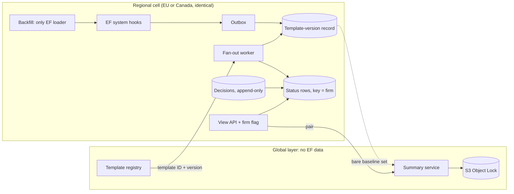

# Architecture: pending template updates for Engagement Files

## Document version

Version 2.0, 2026-11-01. Rewrites v1.0 (2026-10-30), written before the code. Changed: organised around the brief's topics; claims now match the code and READMEs (528 Java and 35 UI tests as reported there, not re-run for this revision); ADR clarifications of 2026-10-30 and 2026-11-01 reflected; no ADR status changed. Requirement IDs are in `specs/` (`docs/01-requirements.md` does not exist). ADRs: `docs/ADR/`. "(to agree)" marks a proposal; the cost ceiling X is unset.

## 1. Architecture and data ownership

**Regional cells plus a thin global layer** (ADR 0001, Proposed; NFR-35..37). Each region (EU, Canada) is a full cell. The global layer holds only template versions, diffs and summaries, never EF content or IDs. A cell consumes the publish event (template ID and version only, FR-9) and reads summaries by (baseline, target).

| Owner | Data | ADR |
|---|---|---|
| Global | Versions, parents, branch, withdrawn flag; diffs; summary records, pair index, lease | 0004, 0010, 0011 |
| Cell | One current record per EF, work items, status rows, decisions, DLQ, flag | 0002, 0006, 0008, 0009, 0014 |
| EF team | EF loading, create/accept processing, the outbox hook point | 0002, 0003 |

Only a bare set of (template, version) baselines leaves a cell, with no counts or IDs (ADR 0001, pending user confirmation). No EF data reaches a model (NFR-37). A firm is pinned to one region.

**Load-bearing decision: no EF load on a read or publish path** (NFR-21, NFR-22; ADR 0005). Fan-out finds EFs from the template-version record (FR-14), and the "downstream call" is a marker write to the status store. Hooks fill records through a local outbox so EF operations are never blocked (FR-1..5, NFR-3; ADR 0002); a rate-limited backfill is the only EF loader (ADR 0003).

## 2. Correctness and production evolution

- **Version graph** (FR-8, FR-11; ADR 0004, Proposed). Eligible version = latest published, in-branch version reachable from the baseline. Withdrawn versions are traversable, never selectable (v1, withdrawn v6, v7 still offers v7). Ties break on (publishedAt, version ID): one total order, so insertion order is irrelevant (NFR-6). Unreachable later version is Unknown (FR-12); nothing newer is UpToDate. Withdrawal is a flag, never a delete (FR-10, NFR-7).
- **Decline pins (EF, version)** (FR-27..30; ADR 0009, Proposed). Decisions are append-only; decline never moves the baseline; accept sets it (FR-4). Status is derived from record, graph and decline set, so v7 containing declined v5 is offered from the old baseline as one cumulative update (FR-26, FR-30). Declining the latest eligible version shows up to date (Q8, user-confirmed).
- **Idempotency, monotonic writes** (ADR 0006). One work item per (EF, template, target) by conditional put (FR-15, NFR-27). The marker write is a compare-and-set in graph order, so replays and reordering cannot change the final state (FR-17, NFR-12). Delivery is at-least-once: a crash between marker and DONE repeats the call, safe only because it is monotonic. Completion (FR-21) is derived from stored item states; a counter drifted after a crash.
- **Supersession** (FR-20): an older or withdrawn target ends `SKIPPED(SUPERSEDED)` with no call.
- **A failure is never "no update"** (FR-19, FR-25). Exhausted retries go to the DLQ and the EF becomes unknown; derive and read failures are unknown; the UI maps errors to unknown. Known hole (W1): if the status store is down while a healthy UP_TO_DATE row exists, the failed write is swallowed and counted, and the old row stays until reconciliation, which is not built.
- **Reconciliation** (ADR 0013, NFR-28): recompute every status from records, graph and decisions, no EF load. Only the primitive `refreshFirm` exists.
- **Rollout** (NFR-40..43; ADR 0014). Per-firm flag in the firm's region gates hooks, fan-out writes, reads and decisions; additive tables; off means inert data. Beans are off by default in code.
- **From in-memory ports to AWS.** Records, work items, status, decisions to DynamoDB (conditional put and CAS become `ConditionExpression`s); dispatch to SQS (visibility timeout replaces the lease, redrive the DLQ sink); summaries to S3 Object Lock plus a DynamoDB pointer; then scheduler, relay host, reconciler. Race and timeout semantics are untested.

## 3. Scale and cost

| Quantity | Arithmetic | Result |
|---|---|---|
| Scan all EFs | 800,000 x 1 min | 13,333 h (556 days single-threaded) |
| Backfill in 14 days (NFR-5) | 13,333 h / 336 h | 40 concurrent: 13.9 days; 50: 11.1; 20: 28 |
| Load per publish | 800,000 / 40 = 20,000 EFs x 1 min | 333 h: infeasible |
| Fan-out | 40 publishes/week x 20,000 | 800,000 conditional writes/week, ~1.3/s |
| Burst (NFR-13) | 20,000 / 10 s | ~2,000 calls/s per publish |
| Reconciliation | 800,000 / 86,400 s | ~9.3 records/s, 0 loads |
| Largest firm | 40,000 EFs (5%) | 500/s at 25% cap = 80 s; alone at 2,000/s = 20 s |

- Loads are paid once, by backfill, under its own limit (default 50, runtime-tunable, not shared with fan-out; ADR 0003). If the owning team grants 20, the target becomes 28 days; the limit stays.
- Burst feasibility reduces to marker latency L: in-flight needed is 2,000 x L. The placeholder `max-in-flight=50` meets 10 s only if L <= 25 ms. L is unknown (Q1).
- The 40,000-EF firm misses NFR-13 under contention (80 s) and by 2x even alone (20 s vs 10 s). NFR-11 conflicts with NFR-13 by design (ADR 0007): stated, not solved.
- That firm's status list is ~40 MB if read whole (40,000 x ~1 KB), so it is paged (NFR-14, ADR 0008).
- **Summary cost scales with versions, not EFs** (FR-36). Pairs/week = 40 x B, B = distinct baselines in use per product (not given). Monthly cost = 40 x B x ~4.33 x (tokens_in x price_in + tokens_out x price_out) + evaluation runs. A per-firm key would multiply it by up to 4,000. X is unset (NFR-26): no dollar figure.

## 4. Summary generation and evaluation

Pipeline (ADR 0010..0012). On publish, one job per baseline in use whose eligible target is the new version (FR-35); a missing pair on open enqueues the same job (FR-34). A lease gives single-flight per pair. The model sees the JSON diff only (FR-37) and returns statements with `diffItemIds`. The validator rejects missing or unknown IDs and raw JSON paths (FR-38, FR-41); a rejection stores nothing. Failures retry, then DLQ; the view shows "generating" or "unavailable" and never alters the update status (FR-42).

**Defending a March summary in November** (NFR-15..17). One S3 object per generation holds text, statements, the diff, model ID, prompt version and generation time (FR-39, FR-40) under Object Lock (7 years, to agree); a SHA-256 is checked on read and a mismatch shows "unavailable". No update or delete exists; regeneration appends and moves the pointer. The model ID is an exact pinned version (an alias fails startup; the check is a deny-list). A re-run is not bit-identical, so the stored record is the evidence. The validator checks structure, not truth. Every summary is labelled AI-generated (FR-43).

**Evaluation** (NFR-18, 19; ADR 0012). A labelled reference set gates release: unsupported statements at most 1%, omitted labelled items at most 5% (proposals, configurable). The harness exists and exits non-zero above them, but only a fake model and a synthetic set have run through it.

## 5. Tradeoffs, assumptions, the requirement to challenge

- Fast answers for EFs with a record, `unknown` for the rest, instead of a scan that cannot finish; the price is coverage-dependent UI and an outbox change in a team we do not own (to agree).
- AIMD plus a work-conserving firm cap instead of a fixed rate: tuning cost, but no need to know the downstream limit (ADR 0007).
- Object Lock makes a wrong summary undeletable until retention ends (Q13, erasure).
- Assumptions: the marker is a write, not an EF load; baselines may reach the global layer; 7-year retention; every "(to agree)".

**Requirement to challenge: "real time, within seconds".** Split it: the indicator within seconds (10 s p95 proposed) for EFs with a record (NFR-13); summaries within minutes (5 min p95 proposed, NFR-20); everything else `unknown` (FR-24), never "up to date", until backfill reaches it (up to 14 days).

## 6. Migration, events, operations, recovery

- **Backfill.** Enumerate record-less EFs, re-check before each load, load under its own limit, write the same idempotent record. Failures retry with capped backoff, none given up (FR-7). Coverage is "100% attempted, failures counted" (ADR 0003).
- **Unreliable events.** Dedupe by key, monotonic writes, lease-expiry redelivery, DLQ retained 14 days (to agree; NFR-29, NFR-32).
- **Observability.** Meters that exist: backlog, in-flight, limit, DLQ depth, publish-to-marker latency, backfill coverage, summary failures by kind (NFR-38). The backlog gauge counts firms with ready work, not items. Proposed SLOs, all to agree: indicator 10 s p95; list 1 s p95 (NFR-14); summary 5 min p95; view availability 99.9% (NFR-31); DLQ depth above 0 for 15 min alarms (NFR-39); drift repaired within 24 h (NFR-28). Alert rules and dashboards are not built.
- **Residency.** Work items, status, decisions, flag and metrics stay in the cell. The event type has no EF field and the summary types have no EF or firm ID (both checked by tests). Real deployment residency is unverified.
- **Recovery.** Outage: durable queue, resume, drain at the same limits (NFR-32). Poison item: DLQ, EF unknown, others unaffected. Lost event: reconciliation (not built). A feature failure never blocks EF operations (NFR-30).

## 7. Riskiest part

**The marker write (ADR 0005, Proposed) and the capacity of whoever owns it (Q1).** Section 3 hangs on it: if the call is the 1-minute load, NFR-13 and NFR-25 fail. Second risk: a hook recording a wrong version, which nothing detects without an EF load (ADR 0002).

First in production: (1) get Q1 answered in writing: owner, p95 latency, capacity, shared budget with backfill; (2) make the marker a write to a store we own in the cell, so Q1 becomes ordinary DynamoDB capacity (my recommendation; ADR 0005 leaves the owner open); (3) enable one small firm, measure L, and compare hook-recorded versions with backfill-loaded ones for a sample; (4) then the largest firm alone.

## 8. What was built and verified

`fanout-worker/` (Java 21, Spring Boot, in-memory ports): 528 tests, 0 failures in the last README-reported run; UI: 35 tests and a successful build. Specs 01 to 05 are implemented as P2 code, spec 03 (the required worker) in full; spec 06 is Pending. A dev web layer and minimal Angular UI use header identity, which is a stub, not authentication.

Defects independent QA found that the builders' tests missed (all fixed, regression-tested):

- A crash between the terminal CAS and a counter left a publish never complete (FR-21).
- A withdrawn version could become the pending target (FR-20).
- A crafted EF reference let one firm's decision remove another firm's pending update (NFR-33).
- A summary job was dropped when a dead worker held the lease (FR-35).

**Not verified:** no real DynamoDB, SQS or S3 Object Lock; no real model; no real browser (jsdom only, no contrast or keyboard check); no real downstream; nothing at 800,000 EFs. Timings are in-memory and indicative. NFR-13, 14, 20, 24, 26, 31 and 43 cannot be tested here.

## 9. Left out

Applying template content; real authentication; AWS adapters; scheduler, relay host, reconciliation job; DLQ redrive; Object Lock retention and erasure policy; cost; UI extras (decision history, server-side filter, withdrawn display); per-EF version history; backfill priority; automated rollback; KMS signing; online review of summaries.

## 10. Open decisions

- Still Proposed: 0001 (baseline export), 0002 (current vs history), 0005 (marker owner). 0004 (tie-break, withdrawn traversal) and 0009 (declined-latest) were promoted to Accepted on 2026-11-01 after the user answered their open questions; 0004 keeps Q7 (how withdrawal is communicated) open. Accepted 0006..0008 rest on Proposed 0005 and 0001.
- Q1 capacity; Q4 dead-lettered as complete; Q13 retention vs erasure; Q14 cost X.
- FR-36 says "shall not regenerate"; ADR 0010 allows an explicit appending supersede. Amend the wording.
- Document conflicts: ADR 0008 cites DynamoDB "read replicas"; ADR 0011 says the pointer is the only mutable item, ADR 0010 adds a lease; ADR 0006's Decision still says "counter" (superseded by its clarification 7); ADR 0001 "exported" vs 0010 "aggregated", transport undefined; the record has no firm ID though status is keyed by firm (code uses `EfFirmLookup`).
